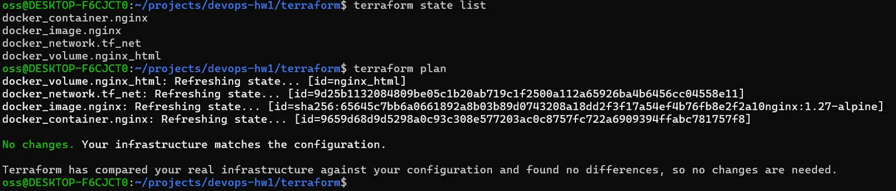
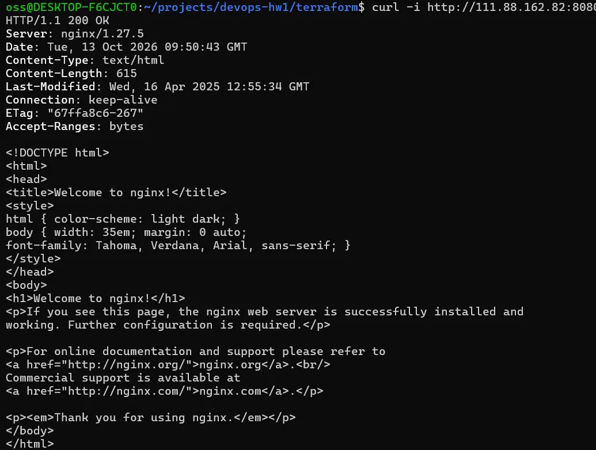
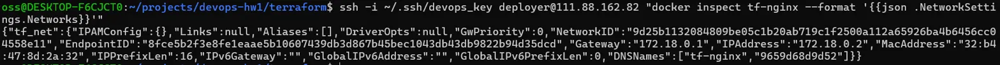
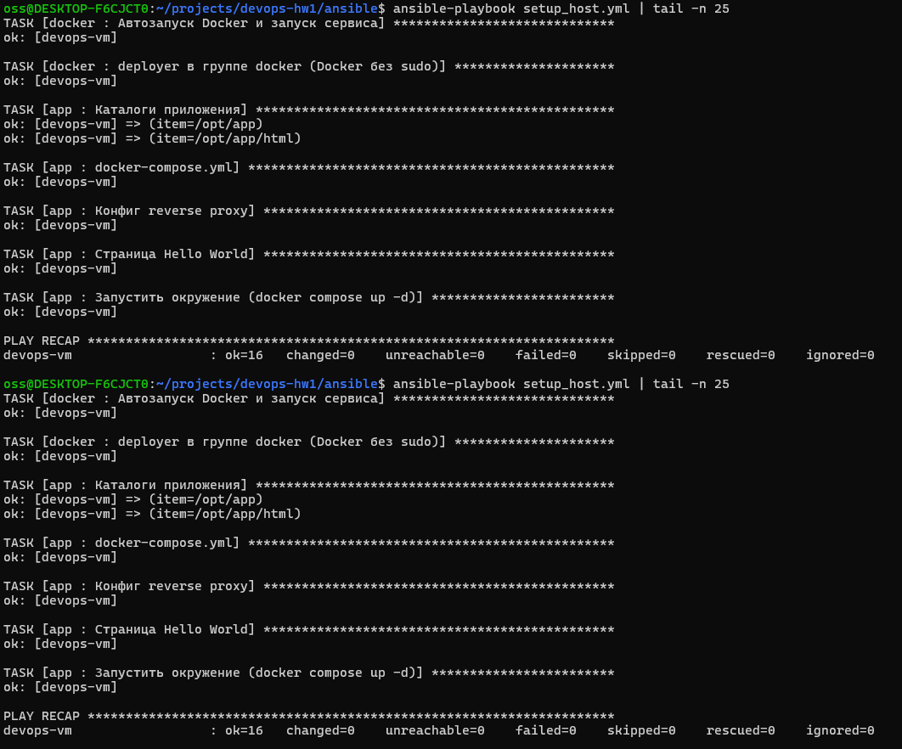
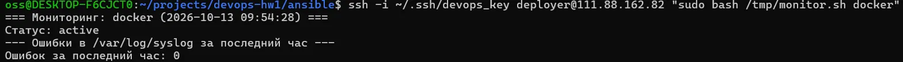
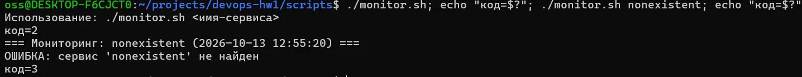
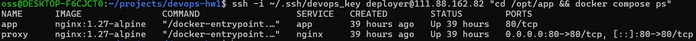
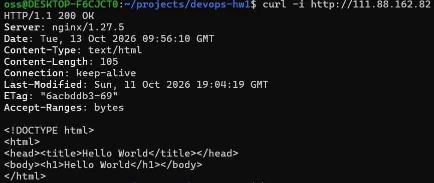

# ДЗ #1: Фундамент DevOps-инфраструктуры

## Что сделано

| Часть | Инструмент | Результат |
|---|---|---|
| Настройка хоста | Ansible | пользователь `deployer`, Docker, автозапуск, окружение в `/opt/app` |
| Контейнер с томом и сетью | Terraform (провайдер docker) | nginx в сети `tf_net`, том `nginx_html`, порт 8080 |
| Мониторинг | Bash | `scripts/monitor.sh` |
| Multi-service окружение | Docker Compose | `proxy` (nginx, порт 80) и `app` (Hello World) в сети `app_net` |

## Структура репозитория

```
ansible/
  ansible.cfg
  inventory.ini
  setup_host.yml
  roles/
    users/tasks/main.yml
    docker/tasks/main.yml
    app/
terraform/
  main.tf  variables.tf  outputs.tf
scripts/
  monitor.sh
docs/
```

## Требования

- Локально (WSL/Ubuntu): `ansible`, `terraform`, `git`.
- Выданная VM с Ubuntu 24.04, SSH-доступ по ключу.

## Развёртывание

1. Создать SSH-ключ и положить его на VM (`ssh-keygen`, `ssh-copy-id`). В `ansible/inventory.ini` указать IP, пользователя и путь к ключу.
2. Настроить хост и поднять Compose-окружение:
```bash
   cd ansible
   ansible-playbook setup_host.yml
```
3. Поднять nginx через Terraform:
```bash
   cd terraform
   echo 'vm_ip = "<IP VM>"' > terraform.tfvars
   terraform init
   terraform plan
   terraform apply
```
4. Проверить:
```bash
   curl -i http://<IP>:8080
   curl -i http://<IP>
```
5. Мониторинг: `bash scripts/monitor.sh docker` (на VM, для чтения syslog нужен `sudo`).

## Результаты

### Terraform

Ресурсы и повторный `plan` без изменений:



Контейнер на нестандартном порту отдаёт `200 OK`:



Контейнер подключён только к новой сети `tf_net`:



### Ansible: идемпотентность

Второй запуск playbook, `changed=0`:



### monitor.sh

Проверка работающего сервиса и подсчёт ошибок в syslog:



Обработка ошибок (нет аргумента, сервис не найден):



### Docker Compose

Контейнеры запущены, наружу опубликован только порт proxy:



Доступ через reverse proxy:



## Архитектурные решения

- **Роли Ansible.** Код разделён на роли `users`, `docker`, `app`: каждая отвечает за свою часть, их можно менять независимо.
- **Идемпотентность.** Используются модули `user`, `apt`, `copy`, `file`, `community.docker.docker_compose_v2`: они сравнивают текущее состояние с описанным.
- **Sudo.** Файл `/etc/sudoers.d/deployer` проверяется через `visudo -cf` до записи, чтобы битый файл не сломал sudo.
- **Две сети.** Terraform-контейнер живёт в `tf_net`, Compose-окружение в `app_net`. Они не связаны между собой. Порты разные: 8080 и 80.
- **Reverse proxy.** Наружу опубликован только порт `proxy`. У `app` порт внутренний, до него можно достучаться только через прокси.
- **Terraform управляет Docker по SSH.** Провайдер подключается к Docker на VM под `deployer` по ключу.
- **Секреты.** Ключи, `terraform.tfstate` и `terraform.tfvars` в `.gitignore` и в репозиторий не попадают.

## Проблемы и решения

1. **GitHub не принимал пароль по HTTPS**, и в логине была опечатка. Перешёл на доступ по SSH-ключу и исправил адрес remote.
2. **Репозиторий HashiCorp и реестр Terraform недоступны** (404 на apt-репозитории, `connection reset by peer` на `registry.terraform.io`). Terraform установлен через snap, провайдер `kreuzwerker/docker` v3.0.2 скачан с GitHub и положен в `~/.terraform.d/plugins`.
3. **`terraform plan` предлагал пересоздать контейнер** из-за расхождения атрибута `network_mode`. Решено блоком `lifecycle { ignore_changes = [network_mode] }`, после чего `plan` показывает `No changes`.
4. **`deployer` не может читать `/var/log/syslog`.** `monitor.sh` сообщает об этом и без `sudo` пропускает подсчёт, а с `sudo` считает ошибки.
